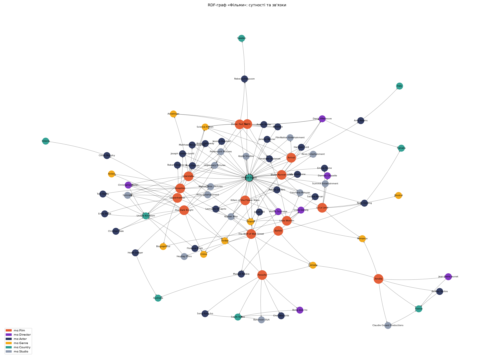
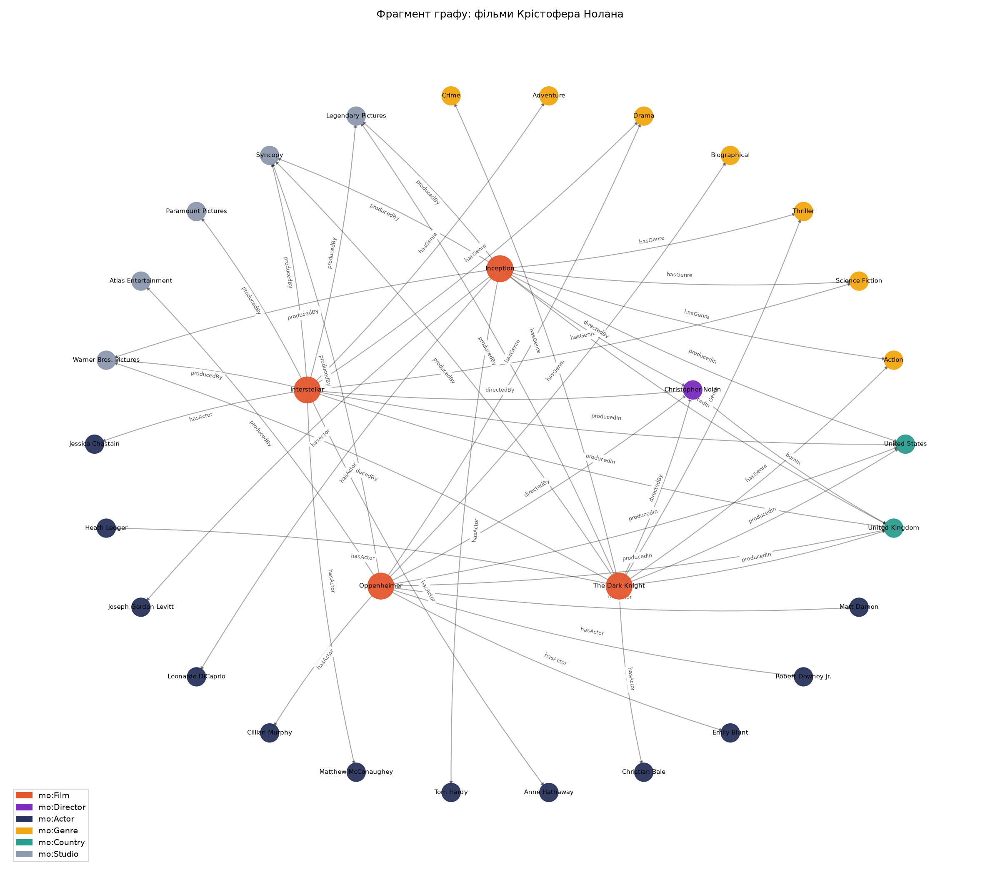

# Лабораторна робота №01 — Технології Semantic Web: RDF та SPARQL

**Дисципліна:** Принципи, методи зв'язування даних у застосуваннях семантичної павутини
**Викладач:** Тимчук Олег Сергійович
**Студент:** Дубовик Максим, група ІПЗм-11
**Предметна область:** Фільми

---

## Зміст

1. [Опис предметної області та джерело даних](#1-опис-предметної-області-та-джерело-даних)
2. [Структура RDF-графу та його візуалізація](#2-структура-rdf-графу-та-його-візуалізація)
3. [Приклади RDF-трійок і Turtle](#3-приклади-rdf-трійок-і-turtle)
4. [SPARQL-запити та результати їх виконання](#4-sparql-запити-та-результати-їх-виконання)
5. [Зв'язок із Wikidata](#5-звязок-із-wikidata)
6. [Помилкові та виправлені приклади](#6-помилкові-та-виправлені-приклади)
7. [Висновки](#7-висновки)
8. [Репозиторій і запуск](#8-репозиторій-і-запуск)

---

## 1. Опис предметної області та джерело даних

Предметна область — **фільми**: фільми, режисери, актори, жанри, країни виробництва та кінокомпанії.

**Джерело даних.** Набір даних сформовано самостійно ([data.py](data.py)) на основі загальнодоступної інформації з Wikipedia та IMDb (рейтинги IMDb наближені, станом на 2025 р.). До набору входять 15 відомих фільмів 2001–2024 рр. сімох режисерів (Christopher Nolan, Denis Villeneuve, Martin Scorsese, Greta Gerwig, Bong Joon-ho, Jean-Pierre Jeunet, Damien Chazelle). Ще один фільм (*Tenet*) і двох акторів додано вручну в Turtle-файл (див. п. 3.3). Для зовнішніх даних використано **Wikidata** (п. 5).

**Питання до графу** (кожне реалізоване SPARQL-запитом у п. 4):

| № | Питання |
|---|---|
| Q1 | Які фільми зняв Крістофер Нолан? |
| Q2 | Які фільми вийшли після 2020 року і хто їх режисер? |
| Q3 | Який режисер має найбільше фільмів у графі (і який у нього середній рейтинг)? |
| Q4 | Які актори брали участь у фільмах жанру «Science Fiction»? |
| Q5 | Які актори, народжені не у США, грали у фільмах режисерів, народжених у Великій Британії? |
| Q6 | Який середній / мінімальний / максимальний рейтинг і середня тривалість фільмів за жанрами? |
| Q7 | Які актори знімалися у кількох фільмах графу і в яких режисерів? |
| Q8 | Які фільми знято студіями, що базуються поза США? |

---

## 2. Структура RDF-графу та його візуалізація

### 2.1 Простори імен (власні URI)

| Префікс | URI | Призначення |
|---|---|---|
| `mo:` | `http://example.org/movies/ontology#` | власні класи та властивості |
| `film:` | `http://example.org/movies/film/` | фільми |
| `person:` | `http://example.org/movies/person/` | режисери й актори |
| `genre:` | `http://example.org/movies/genre/` | жанри |
| `country:` | `http://example.org/movies/country/` | країни |
| `studio:` | `http://example.org/movies/studio/` | кінокомпанії |

### 2.2 Використані існуючі словники

| Словник | Що використано |
|---|---|
| **FOAF** | `foaf:Person` (тип усіх людей), `foaf:name` (імена) |
| **Dublin Core Terms** | `dcterms:title` (назви фільмів) |
| **Schema.org** | батьківські класи й властивості: `mo:Film rdfs:subClassOf schema:Movie`, `mo:directedBy rdfs:subPropertyOf schema:director`, `mo:hasActor ⊑ schema:actor`, `mo:hasGenre ⊑ schema:genre`, `mo:producedIn ⊑ schema:countryOfOrigin`, `mo:producedBy ⊑ schema:productionCompany` |
| **RDFS / OWL** | опис онтології (`owl:Class`, `owl:ObjectProperty`, `rdfs:domain`, `rdfs:range`), `rdfs:label`, `owl:sameAs` |
| **SKOS** | `skos:exactMatch` для зв'язку жанрів із Wikidata |

### 2.3 Типи сутностей (класи)

| Клас | Батьківський клас | Екземплярів |
|---|---|---|
| `mo:Film` | `schema:Movie` | 15 (+1 вручну = 16) |
| `mo:Director` | `mo:Person` ⊑ `foaf:Person` | 7 |
| `mo:Actor` | `mo:Person` ⊑ `foaf:Person` | 30 (+2 вручну = 32) |
| `mo:Genre` | `schema:Thing` | 10 |
| `mo:Country` | `schema:Country` | 9 |
| `mo:Studio` | `schema:Organization` | 14 |

### 2.4 Типи зв'язків між сутностями

| Властивість | Домен → Діапазон | Батьківська властивість |
|---|---|---|
| `mo:directedBy` | Film → Director | `schema:director` |
| `mo:hasActor` | Film → Actor | `schema:actor` |
| `mo:hasGenre` | Film → Genre | `schema:genre` |
| `mo:producedIn` | Film → Country | `schema:countryOfOrigin` |
| `mo:producedBy` | Film → Studio | `schema:productionCompany` |
| `mo:bornIn` | Person → Country | — |
| `mo:basedIn` | Studio → Country | — |

Властивості-літерали: `dcterms:title`, `foaf:name`, `rdfs:label`, `mo:releaseYear` (xsd:integer), `mo:runtimeMinutes` (xsd:integer), `mo:imdbRating` (xsd:decimal), `mo:birthYear` (xsd:integer).

### 2.5 Відповідність вимогам

Статистика, яку виводить [build_graph.py](build_graph.py):

```
Екземпляри за типами:
  mo:Actor       30
  mo:Film        15
  mo:Studio      14
  mo:Genre       10
  mo:Country     9
  mo:Director    7
Унікальних екземплярів: 85
Типів зв'язків між сутностями: 7 -> mo:basedIn, mo:bornIn, mo:directedBy, mo:hasActor, mo:hasGenre, mo:producedBy, mo:producedIn
Всього трійок: 532
```

| Вимога | Потрібно | Є |
|---|---|---|
| Типів сутностей | ≥ 5 | **6** |
| Екземплярів | ≥ 20 | **85** (88 після ручних змін) |
| Типів зв'язків | ≥ 5 | **7** |
| RDF-трійок | ≥ 50 | **532** (557 після ручних змін, 599 разом із зв'язками з Wikidata) |
| Власні URI | так | `http://example.org/movies/...` |
| Існуючий словник | ≥ 1 | FOAF, Dublin Core, Schema.org, SKOS |

### 2.6 Візуалізація

Візуалізацію побудовано скриптом [visualize.py](visualize.py) (networkx + matplotlib). На графі показано всі сутності та зв'язки між ними (без літералів); колір вузла відповідає класу.

**Повний граф** (85 вузлів, 184 ребра):



**Фрагмент: фільми Крістофера Нолана** (з підписами зв'язків):



---

## 3. Приклади RDF-трійок і Turtle

### 3.1 Фрагмент Turtle ([output/movies.ttl](output/movies.ttl))

```turtle
@prefix country: <http://example.org/movies/country/> .
@prefix dcterms: <http://purl.org/dc/terms/> .
@prefix film:    <http://example.org/movies/film/> .
@prefix foaf:    <http://xmlns.com/foaf/0.1/> .
@prefix genre:   <http://example.org/movies/genre/> .
@prefix mo:      <http://example.org/movies/ontology#> .
@prefix owl:     <http://www.w3.org/2002/07/owl#> .
@prefix person:  <http://example.org/movies/person/> .
@prefix rdfs:    <http://www.w3.org/2000/01/rdf-schema#> .
@prefix schema:  <https://schema.org/> .
@prefix studio:  <http://example.org/movies/studio/> .

mo:Film a owl:Class ;
    rdfs:label "Film"@en ;
    rdfs:subClassOf schema:Movie .

mo:directedBy a owl:ObjectProperty ;
    rdfs:domain mo:Film ;
    rdfs:range mo:Director ;
    rdfs:subPropertyOf schema:director .

film:Inception a mo:Film ;
    mo:directedBy person:ChristopherNolan ;
    mo:hasActor person:JosephGordonLevitt,
        person:LeonardoDiCaprio,
        person:TomHardy ;
    mo:hasGenre genre:Action,
        genre:SciFi,
        genre:Thriller ;
    mo:imdbRating 8.8 ;
    mo:producedBy studio:Legendary,
        studio:Syncopy,
        studio:WarnerBros ;
    mo:producedIn country:UK,
        country:USA ;
    mo:releaseYear 2010 ;
    mo:runtimeMinutes 148 ;
    dcterms:title "Inception"@en .

person:ChristopherNolan a mo:Director, foaf:Person ;
    mo:birthYear 1970 ;
    mo:bornIn country:UK ;
    foaf:name "Christopher Nolan" .
```

### 3.2 Інші формати серіалізації

Граф також серіалізовано в **N-Triples** ([output/movies.nt](output/movies.nt)), **JSON-LD** ([output/movies.jsonld](output/movies.jsonld)) і **RDF/XML** ([output/movies.rdf](output/movies.rdf)). Скрипт [work_with_graph.py](work_with_graph.py) перечитує кожен файл і перевіряє, що граф ізоморфний Turtle-версії:

```
  movies.jsonld  трійок: 532  ізоморфний Turtle-графу: True
  movies.nt      трійок: 532  ізоморфний Turtle-графу: True
  movies.rdf     трійок: 532  ізоморфний Turtle-графу: True
```

Ті самі трійки в N-Triples:

```
<http://example.org/movies/film/Inception> <http://example.org/movies/ontology#directedBy> <http://example.org/movies/person/ChristopherNolan> .
<http://example.org/movies/film/Inception> <http://example.org/movies/ontology#releaseYear> "2010"^^<http://www.w3.org/2001/XMLSchema#integer> .
<http://example.org/movies/film/Inception> <http://purl.org/dc/terms/title> "Inception"@en .
```

і в JSON-LD (фрагмент):

```json
{
  "@id": "http://example.org/movies/film/Inception",
  "@type": ["http://example.org/movies/ontology#Film"],
  "http://example.org/movies/ontology#directedBy": [
    { "@id": "http://example.org/movies/person/ChristopherNolan" }
  ],
  "http://example.org/movies/ontology#hasGenre": [
    { "@id": "http://example.org/movies/genre/SciFi" },
    { "@id": "http://example.org/movies/genre/Action" },
    { "@id": "http://example.org/movies/genre/Thriller" }
  ]
}
```

### 3.3 Ручні зміни Turtle-файлу

Згенерований `output/movies.ttl` скопійовано у [movies_edited.ttl](movies_edited.ttl) і **вручну** відредаговано:

1. додано новий фільм `film:Tenet` (2020, реж. Christopher Nolan) і двох нових акторів — `person:JohnDavidWashington`, `person:RobertPattinson`;
2. до `film:Inception` додано опис `rdfs:comment`;
3. змінено рейтинг `film:TheDarkKnight`: 9.0 → 9.1.

```turtle
film:Tenet a mo:Film ;
    dcterms:title "Tenet"@en ;
    mo:releaseYear 2020 ;
    mo:runtimeMinutes 150 ;
    mo:imdbRating 7.3 ;
    mo:directedBy person:ChristopherNolan ;
    mo:hasActor person:JohnDavidWashington,
        person:RobertPattinson ;
    mo:hasGenre genre:SciFi,
        genre:Action ;
    mo:producedIn country:USA,
        country:UK ;
    mo:producedBy studio:WarnerBros,
        studio:Syncopy .

person:RobertPattinson a mo:Actor, foaf:Person ;
    foaf:name "Robert Pattinson" ;
    mo:birthYear 1986 ;
    mo:bornIn country:UK .
```

RDFLib читає обидва файли й обчислює різницю (`rdflib.compare.graph_diff`):

```
Трійок до змін: 532, після змін: 557

Додані трійки (26):
  film:Inception  rdfs:comment  "A thief who steals corporate secrets through dream-sharing technology."@en .
  film:Tenet  mo:directedBy  person:ChristopherNolan .
  film:Tenet  mo:hasActor  person:JohnDavidWashington .
  ...
  film:TheDarkKnight  mo:imdbRating  "9.1"^^xsd:decimal .
  ...
Видалені трійки (1):
  film:TheDarkKnight  mo:imdbRating  "9.0"^^xsd:decimal .
```

Усі подальші запити виконуються над відредагованим графом `movies_edited.ttl`.

### 3.4 Вивід вибраних трійок

Усі трійки з предикатом `mo:directedBy` (`g.triples((None, MO.directedBy, None))`):

```
  film:Amelie  mo:directedBy  person:JeanPierreJeunet .
  film:Arrival  mo:directedBy  person:DenisVilleneuve .
  film:Barbie  mo:directedBy  person:GretaGerwig .
  film:BladeRunner2049  mo:directedBy  person:DenisVilleneuve .
  film:Dune  mo:directedBy  person:DenisVilleneuve .
  film:DunePartTwo  mo:directedBy  person:DenisVilleneuve .
  film:Inception  mo:directedBy  person:ChristopherNolan .
  film:Interstellar  mo:directedBy  person:ChristopherNolan .
  film:KillersOfTheFlowerMoon  mo:directedBy  person:MartinScorsese .
  film:LaLaLand  mo:directedBy  person:DamienChazelle .
  film:LittleWomen  mo:directedBy  person:GretaGerwig .
  film:Oppenheimer  mo:directedBy  person:ChristopherNolan .
  film:Parasite  mo:directedBy  person:BongJoonHo .
  film:Tenet  mo:directedBy  person:ChristopherNolan .
  film:TheDarkKnight  mo:directedBy  person:ChristopherNolan .
  film:TheWolfOfWallStreet  mo:directedBy  person:MartinScorsese .
```

### 3.5 Трійки, пов'язані з конкретною сутністю

`person:LeonardoDiCaprio` як суб'єкт **або** об'єкт (`g.triples((s, None, None)) ∪ g.triples((None, None, s))`):

```
  film:Inception  mo:hasActor  person:LeonardoDiCaprio .
  film:KillersOfTheFlowerMoon  mo:hasActor  person:LeonardoDiCaprio .
  film:TheWolfOfWallStreet  mo:hasActor  person:LeonardoDiCaprio .
  person:LeonardoDiCaprio  mo:birthYear  "1974"^^xsd:integer .
  person:LeonardoDiCaprio  mo:bornIn  country:USA .
  person:LeonardoDiCaprio  rdf:type  mo:Actor .
  person:LeonardoDiCaprio  rdf:type  foaf:Person .
  person:LeonardoDiCaprio  foaf:name  "Leonardo DiCaprio" .
```

Також скрипт виводить усі трійки `film:Inception` і опис нового фільму `film:Tenet` через `g.predicate_objects()`. Повний вивід — у [output/run_log.txt](output/run_log.txt).

---

## 4. SPARQL-запити та результати їх виконання

Запити виконуються скриптом [queries.py](queries.py) над графом `movies_edited.ttl` (557 трійок). До кожного запиту автоматично додаються префікси:

```sparql
PREFIX mo:      <http://example.org/movies/ontology#>
PREFIX film:    <http://example.org/movies/film/>
PREFIX person:  <http://example.org/movies/person/>
PREFIX genre:   <http://example.org/movies/genre/>
PREFIX country: <http://example.org/movies/country/>
PREFIX foaf:    <http://xmlns.com/foaf/0.1/>
PREFIX dcterms: <http://purl.org/dc/terms/>
PREFIX rdfs:    <http://www.w3.org/2000/01/rdf-schema#>
```

**Покриття вимог:**

| Вимога | Запити |
|---|---|
| `FILTER` | Q2, Q5, Q8 (`FILTER NOT EXISTS`) |
| `ORDER BY` | усі |
| зв'язки між різними типами сутностей | Q2, Q4, Q5, Q7, Q8 |
| агрегатні функції | Q3 (`COUNT`, `AVG`), Q6 (`AVG`, `MIN`, `MAX`, `COUNT` + `HAVING`), Q7 (`COUNT` + `HAVING`) |
| перехід через ≥ 3 зв'язки | Q5: Actor ←`hasActor`— Film —`directedBy`→ Director —`bornIn`→ Country (+ `bornIn` актора) |

### Q1. Які фільми зняв Крістофер Нолан?

*Демонструє:* зв'язок Film → Director, ORDER BY

```sparql
SELECT ?title ?year WHERE {
  ?film a mo:Film ;
        dcterms:title ?title ;
        mo:releaseYear ?year ;
        mo:directedBy person:ChristopherNolan .
}
ORDER BY ?year
```

**Результат (5 рядків):**

| title | year |
|---|---|
| The Dark Knight | 2008 |
| Inception | 2010 |
| Interstellar | 2014 |
| Tenet | 2020 |
| Oppenheimer | 2023 |

### Q2. Які фільми вийшли після 2020 року і хто їх режисер?

*Демонструє:* FILTER, ORDER BY, зв'язок Film → Director

```sparql
SELECT ?title ?year ?director WHERE {
  ?film a mo:Film ;
        dcterms:title ?title ;
        mo:releaseYear ?year ;
        mo:directedBy ?d .
  ?d foaf:name ?director .
  FILTER (?year > 2020)
}
ORDER BY DESC(?year) ?title
```

**Результат (5 рядків):**

| title | year | director |
|---|---|---|
| Dune: Part Two | 2024 | Denis Villeneuve |
| Barbie | 2023 | Greta Gerwig |
| Killers of the Flower Moon | 2023 | Martin Scorsese |
| Oppenheimer | 2023 | Christopher Nolan |
| Dune | 2021 | Denis Villeneuve |

### Q3. Який режисер має найбільше фільмів у графі (і який у нього середній рейтинг)?

*Демонструє:* агрегатні функції COUNT, AVG, GROUP BY, ORDER BY

```sparql
SELECT ?director (COUNT(?film) AS ?films) (ROUND(AVG(?rating) * 100) / 100 AS ?avgRating) WHERE {
  ?film a mo:Film ;
        mo:directedBy ?d ;
        mo:imdbRating ?rating .
  ?d foaf:name ?director .
}
GROUP BY ?director
ORDER BY DESC(?films) DESC(?avgRating)
```

**Результат (7 рядків):**

| director | films | avgRating |
|---|---|---|
| Christopher Nolan | 5 | 8.44 |
| Denis Villeneuve | 4 | 8.1 |
| Martin Scorsese | 2 | 7.9 |
| Greta Gerwig | 2 | 7.3 |
| Bong Joon-ho | 1 | 8.5 |
| Jean-Pierre Jeunet | 1 | 8.3 |
| Damien Chazelle | 1 | 8 |

### Q4. Які актори брали участь у фільмах жанру «Science Fiction»?

*Демонструє:* зв'язки між різними типами сутностей Actor ← Film → Genre, GROUP_CONCAT

```sparql
SELECT ?actor (GROUP_CONCAT(?title; separator=", ") AS ?films) WHERE {
  ?film mo:hasGenre ?genre ;
        mo:hasActor ?a ;
        dcterms:title ?title .
  ?genre rdfs:label "Science Fiction"@en .
  ?a foaf:name ?actor .
}
GROUP BY ?actor
ORDER BY ?actor
```

**Результат (16 рядків):**

| actor | films |
|---|---|
| Amy Adams | Arrival |
| Anne Hathaway | Interstellar |
| Austin Butler | Dune: Part Two |
| Harrison Ford | Blade Runner 2049 |
| Jeremy Renner | Arrival |
| Jessica Chastain | Interstellar |
| John David Washington | Tenet |
| Joseph Gordon-Levitt | Inception |
| Leonardo DiCaprio | Inception |
| Matthew McConaughey | Interstellar |
| Rebecca Ferguson | Dune, Dune: Part Two |
| Robert Pattinson | Tenet |
| Ryan Gosling | Blade Runner 2049 |
| Timothée Chalamet | Dune, Dune: Part Two |
| Tom Hardy | Inception |
| Zendaya | Dune, Dune: Part Two |

### Q5. Які актори, народжені НЕ у США, грали у фільмах режисерів, народжених у Великій Британії?

*Демонструє:* перехід через 3 зв'язки: Actor ←hasActor— Film —directedBy→ Director —bornIn→ Country; FILTER

```sparql
SELECT DISTINCT ?actor ?actorCountry ?title ?director WHERE {
  ?film mo:hasActor ?a ;                 # зв'язок 1
        mo:directedBy ?d ;               # зв'язок 2
        dcterms:title ?title .
  ?d mo:bornIn country:UK ;              # зв'язок 3
     foaf:name ?director .
  ?a foaf:name ?actor ;
     mo:bornIn ?c .
  ?c rdfs:label ?actorCountry .
  FILTER (?c != country:USA)
}
ORDER BY ?actor ?title
```

**Результат (6 рядків):**

| actor | actorCountry | title | director |
|---|---|---|---|
| Christian Bale | United Kingdom | The Dark Knight | Christopher Nolan |
| Cillian Murphy | Ireland | Oppenheimer | Christopher Nolan |
| Emily Blunt | United Kingdom | Oppenheimer | Christopher Nolan |
| Heath Ledger | Australia | The Dark Knight | Christopher Nolan |
| Robert Pattinson | United Kingdom | Tenet | Christopher Nolan |
| Tom Hardy | United Kingdom | Inception | Christopher Nolan |

### Q6. Середній, мінімальний і максимальний рейтинг та середня тривалість фільмів за жанрами

*Демонструє:* AVG, MIN, MAX, COUNT, HAVING

```sparql
SELECT ?genreName (COUNT(?film) AS ?films)
       (ROUND(AVG(?rating) * 100) / 100 AS ?avgRating)
       (MIN(?rating) AS ?minRating) (MAX(?rating) AS ?maxRating)
       (ROUND(AVG(?runtime)) AS ?avgRuntime) WHERE {
  ?film mo:hasGenre ?g ;
        mo:imdbRating ?rating ;
        mo:runtimeMinutes ?runtime .
  ?g rdfs:label ?genreName .
}
GROUP BY ?genreName
HAVING (COUNT(?film) >= 3)
ORDER BY DESC(?avgRating)
```

**Результат (8 рядків):**

| genreName | films | avgRating | minRating | maxRating | avgRuntime |
|---|---|---|---|---|---|
| Thriller | 4 | 8.6 | 8.0 | 9.1 | 149 |
| Action | 3 | 8.4 | 7.3 | 9.1 | 150 |
| Adventure | 3 | 8.4 | 8.0 | 8.7 | 163 |
| Crime | 3 | 8.3 | 7.6 | 9.1 | 179 |
| Science Fiction | 7 | 8.17 | 7.3 | 8.8 | 152 |
| Drama | 7 | 8.11 | 7.6 | 8.7 | 152 |
| Romance | 3 | 8.03 | 7.8 | 8.3 | 128 |
| Comedy | 4 | 7.95 | 6.8 | 8.5 | 137 |

### Q7. Які актори знімалися у кількох фільмах графу і в яких режисерів?

*Демонструє:* COUNT + HAVING, зв'язки Actor ← Film → Director

```sparql
SELECT ?actor (COUNT(DISTINCT ?film) AS ?films)
       (GROUP_CONCAT(DISTINCT ?director; separator=", ") AS ?directors) WHERE {
  ?film mo:hasActor ?a ;
        mo:directedBy ?d .
  ?a foaf:name ?actor .
  ?d foaf:name ?director .
}
GROUP BY ?actor
HAVING (COUNT(DISTINCT ?film) > 1)
ORDER BY DESC(?films) ?actor
```

**Результат (6 рядків):**

| actor | films | directors |
|---|---|---|
| Leonardo DiCaprio | 3 | Christopher Nolan, Martin Scorsese |
| Ryan Gosling | 3 | Denis Villeneuve, Greta Gerwig, Damien Chazelle |
| Timothée Chalamet | 3 | Denis Villeneuve, Greta Gerwig |
| Margot Robbie | 2 | Greta Gerwig, Martin Scorsese |
| Rebecca Ferguson | 2 | Denis Villeneuve |
| Zendaya | 2 | Denis Villeneuve |

### Q8. Які фільми знято студіями, що базуються поза США, і в якій країні ці студії?

*Демонструє:* зв'язки Film → Studio → Country, FILTER NOT EXISTS

```sparql
SELECT ?title ?studioName ?countryName WHERE {
  ?film dcterms:title ?title ;
        mo:producedBy ?studio .
  ?studio rdfs:label ?studioName ;
          mo:basedIn ?c .
  ?c rdfs:label ?countryName .
  FILTER NOT EXISTS { ?studio mo:basedIn country:USA }
}
ORDER BY ?countryName ?title
```

**Результат (8 рядків):**

| title | studioName | countryName |
|---|---|---|
| Amélie | Claudie Ossard Productions | France |
| Parasite | Barunson E&A | South Korea |
| Barbie | Heyday Films | United Kingdom |
| Inception | Syncopy | United Kingdom |
| Interstellar | Syncopy | United Kingdom |
| Oppenheimer | Syncopy | United Kingdom |
| Tenet | Syncopy | United Kingdom |
| The Dark Knight | Syncopy | United Kingdom |

---

## 5. Зв'язок із Wikidata

### 5.1 Встановлені зв'язки

Для сутностей власного графу знайдено відповідні ресурси **Wikidata**. QID шукалися SPARQL-запитами до `https://query.wikidata.org/sparql` (фільм — за англійською назвою + `wdt:P31 wd:Q11424` «фільм» + роком виходу `wdt:P577`; режисер — за іменем + `wdt:P31 wd:Q5` + заняттям `wdt:P106 wd:Q2526255` «кінорежисер»; країна — за назвою + `wdt:P31 wd:Q6256`). Зв'язки додає скрипт [wikidata_link.py](wikidata_link.py), результат — [output/movies_linked.ttl](output/movies_linked.ttl). Усього додано **42 зв'язки**: 16 фільмів, 7 режисерів, 9 країн (`owl:sameAs`) і 10 жанрів (`skos:exactMatch`).

Приклади:

| Ресурс власного графу | Предикат | Ресурс Wikidata |
|---|---|---|
| `http://example.org/movies/film/Inception` | `owl:sameAs` | [`http://www.wikidata.org/entity/Q25188`](https://www.wikidata.org/wiki/Q25188) (Inception) |
| `http://example.org/movies/person/ChristopherNolan` | `owl:sameAs` | [`http://www.wikidata.org/entity/Q25191`](https://www.wikidata.org/wiki/Q25191) (Christopher Nolan) |
| `http://example.org/movies/film/Parasite` | `owl:sameAs` | [`http://www.wikidata.org/entity/Q61448040`](https://www.wikidata.org/wiki/Q61448040) (Parasite) |
| `http://example.org/movies/country/UK` | `owl:sameAs` | [`http://www.wikidata.org/entity/Q145`](https://www.wikidata.org/wiki/Q145) (United Kingdom) |
| `http://example.org/movies/genre/SciFi` | `skos:exactMatch` | [`http://www.wikidata.org/entity/Q471839`](https://www.wikidata.org/wiki/Q471839) (science fiction film) |

```turtle
film:Inception owl:sameAs wd:Q25188 .
person:ChristopherNolan owl:sameAs wd:Q25191 .
genre:SciFi skos:exactMatch wd:Q471839 .
```

### 5.2 Обґрунтування вибору предикатів

* **`owl:sameAs`** — для фільмів, людей і країн. `film:Inception` і `wd:Q25188` позначають **один і той самий реальний об'єкт** — фільм «Початок» 2010 року. Семантика `owl:sameAs` саме така: два URI ідентифікують один індивід, тож усі твердження про один ресурс справедливі й для іншого. Тому можна «доповнювати» власний граф фактами з Wikidata (дата народження режисера, нагороди, бюджет).
* **`skos:exactMatch`** — для жанрів. Жанр — це не реальний об'єкт, а **поняття класифікації**. Наш `genre:SciFi` («Science Fiction» як жанр) і `wd:Q471839` («science fiction film» — клас фільмів у Wikidata) мають однаковий зміст, але змодельовані по-різному. `owl:sameAs` тут був би надто сильним: він переносив би всі властивості класу Wikidata на наш ресурс. `skos:exactMatch` лише стверджує, що два поняття з різних схем можна взаємозамінно використовувати для класифікації.

### 5.3 Перевірка правильності зв'язків

Скрипт автоматично порівнює назви з власного графу з мітками у Wikidata (`rdfs:label` мовою `en` або `mul`) для всіх 42 зв'язків:

```
Перевірено зв'язків: 42; розбіжностей у назвах: 0
```

Примітка: у Wikidata назва *La La Land* (Q20856802) зберігається з мовним тегом `mul` (спільна для всіх мов), а не `en`, тому фільтр враховує обидва теги.

### 5.4 Запити, що використовують власний граф і Wikidata

Запити виконуються в RDFLib через федеративний `SERVICE <https://query.wikidata.org/sparql>`. Частина даних (рейтинг, кількість фільмів, тривалість, `owl:sameAs`) береться з **власного графу**, решта (дата й місце народження, нагороди `P166`, бюджет `P2130`, тривалість `P2047`) — з **Wikidata**. Додаткові префікси:

```sparql
PREFIX owl:  <http://www.w3.org/2002/07/owl#>
PREFIX wd:   <http://www.wikidata.org/entity/>
PREFIX wdt:  <http://www.wikidata.org/prop/direct/>
PREFIX p:    <http://www.wikidata.org/prop/>
PREFIX psn:  <http://www.wikidata.org/prop/statement/value-normalized/>
PREFIX wikibase: <http://wikiba.se/ontology#>
```

### F1. Місто та дата народження режисерів (Wikidata) і кількість їхніх фільмів у власному графі

```sparql
SELECT ?director (COUNT(DISTINCT ?film) AS ?films) ?birthDate
       (GROUP_CONCAT(DISTINCT ?placeName; separator=" / ") AS ?birthPlace) WHERE {
  ?film mo:directedBy ?d .                # власний граф
  ?d foaf:name ?director ;
     owl:sameAs ?wd .                     # зв'язок із Wikidata
  SERVICE <https://query.wikidata.org/sparql> {
    ?wd wdt:P569 ?birthDate ;             # дата народження
        wdt:P19 ?place .                  # місце народження
    ?place rdfs:label ?placeName .
    FILTER (LANG(?placeName) = "en")
  }
}
GROUP BY ?director ?birthDate
ORDER BY DESC(?films) ?director
```

**Результат (7 рядків):**

| director | films | birthDate | birthPlace |
|---|---|---|---|
| Christopher Nolan | 5 | 1970-07-30T00:00:00+00:00 | London / City of Westminster |
| Denis Villeneuve | 4 | 1967-10-03T00:00:00+00:00 | Bécancour |
| Greta Gerwig | 2 | 1983-08-04T00:00:00+00:00 | Sacramento |
| Martin Scorsese | 2 | 1942-11-17T00:00:00+00:00 | Queens |
| Bong Joon-ho | 1 | 1969-09-14T00:00:00+00:00 | Daegu |
| Damien Chazelle | 1 | 1985-01-19T00:00:00+00:00 | Providence |
| Jean-Pierre Jeunet | 1 | 1953-09-03T00:00:00+00:00 | Le Coteau |

### F2. Фільми з рейтингом ≥ 8.0 (власний граф): кількість нагород і бюджет (Wikidata)

```sparql
SELECT ?title ?rating (COUNT(DISTINCT ?award) AS ?awards) (MAX(?budget) AS ?budgetUSD) WHERE {
  ?film dcterms:title ?title ;            # власний граф
        mo:imdbRating ?rating ;
        owl:sameAs ?wd .
  FILTER (?rating >= 8.0)
  SERVICE <https://query.wikidata.org/sparql> {
    OPTIONAL { ?wd wdt:P166 ?award . }  # нагороди
    OPTIONAL { ?wd wdt:P2130 ?budget . } # бюджет
  }
}
GROUP BY ?title ?rating
ORDER BY DESC(?awards)
```

**Результат (11 рядків):**

| title | rating | awards | budgetUSD |
|---|---|---|---|
| Parasite | 8.5 | 14 | 13200000 |
| La La Land | 8.0 | 13 | 30000000 |
| Amélie | 8.3 | 10 | 10000000 |
| Inception | 8.8 | 7 | 160000000 |
| Oppenheimer | 8.3 | 6 | 100000000 |
| The Dark Knight | 9.1 | 4 | 185000000 |
| Blade Runner 2049 | 8.0 | 3 | 150000000 |
| Dune | 8.0 | 3 | 165000000 |
| Dune: Part Two | 8.5 | 2 | 190000000 |
| Interstellar | 8.7 | 2 | 165000000 |
| The Wolf of Wall Street | 8.2 | 1 | 100000000 |

### F3. Звірка даних: тривалість фільму у власному графі та у Wikidata (P2047, нормалізовано)

```sparql
SELECT DISTINCT ?title ?ourRuntime ?wdRuntime (?ourRuntime - ?wdRuntime AS ?diff) WHERE {
  ?film dcterms:title ?title ;
        mo:runtimeMinutes ?ourRuntime ;
        owl:sameAs ?wd .
  SERVICE <https://query.wikidata.org/sparql> {
    # нормалізоване значення (завжди в секундах), а не wdt:P2047 «як введено»
    ?wd p:P2047/psn:P2047/wikibase:quantityAmount ?seconds .
  }
  BIND (ROUND(?seconds / 60) AS ?wdRuntime)
}
ORDER BY ?title
```

**Результат (16 рядків):**

| title | ourRuntime | wdRuntime | diff |
|---|---|---|---|
| Amélie | 122 | 122 | 0 |
| Arrival | 116 | 116 | 0 |
| Barbie | 114 | 114 | 0 |
| Blade Runner 2049 | 163 | 164 | -1 |
| Dune | 155 | 155 | 0 |
| Dune: Part Two | 166 | 165 | 1 |
| Inception | 148 | 148 | 0 |
| Interstellar | 169 | 169 | 0 |
| Killers of the Flower Moon | 206 | 206 | 0 |
| La La Land | 128 | 128 | 0 |
| Little Women | 135 | 134 | 1 |
| Oppenheimer | 180 | 180 | 0 |
| Parasite | 132 | 132 | 0 |
| Tenet | 150 | 150 | 0 |
| The Dark Knight | 152 | 153 | -1 |
| The Wolf of Wall Street | 180 | 180 | 0 |

Запит F3 також працює як перевірка якості даних: тривалості у власному графі та у Wikidata збігаються з точністю до 1 хв (різниця для кількох фільмів пояснюється різними версіями прокату).

---

## 6. Помилкові та виправлені приклади

Усі приклади відтворює скрипт [errors_demo.py](errors_demo.py).

### E1. Синтаксична помилка в Turtle

**Помилково** — не оголошено префікс `dcterms:` і пропущено крапку після `2020`:

```turtle
@prefix mo: <http://example.org/movies/ontology#> .
@prefix film: <http://example.org/movies/film/> .

film:Tenet a mo:Film ;
    dcterms:title "Tenet"@en ;
    mo:releaseYear 2020
film:Dune a mo:Film .
```

```
-> BadSyntax: at line 6 of <>:
```

**Виправлено** — додано `@prefix dcterms: <http://purl.org/dc/terms/> .` і крапку `mo:releaseYear 2020 .` → файл розібрано успішно (4 трійки).

### E2. Рік як рядок замість `xsd:integer`

**Помилково:** `film:Dune mo:releaseYear "2021" .` (рядкові літерали)
**Виправлено:** `film:Dune mo:releaseYear 2021 .` (у Turtle число без лапок = `xsd:integer`)

Запит `SELECT ?f ?year WHERE { ?f mo:releaseYear ?year . FILTER (?year > 2020) }`:

```
Помилково (рядки)          FILTER (?year > 2020) -> ['Amelie', 'Barbie', 'Dune', 'Tenet']
Виправлено (xsd:integer)   FILTER (?year > 2020) -> ['Barbie', 'Dune']
```

Причина: `"2023"` — рядок, тож числового порівняння не відбувається. За специфікацією SPARQL це помилка типу, а RDFLib упорядковує значення різних типів і вважає будь-який рядок «більшим» за число, тому у вибірку потрапили навіть *Tenet* (2020) і *Amélie* (2001). Саме тому в [build_graph.py](build_graph.py) всі числа явно створюються як `Literal(..., datatype=XSD.integer)`.

### E3. Літерал без мовного тегу

```sparql
# Помилково: 0 рядків — у графі мітка "Science Fiction"@en, а "Science Fiction" без тегу — інший літерал
SELECT ?film WHERE { ?film mo:hasGenre ?g . ?g rdfs:label "Science Fiction" . }

# Виправлено: 7 рядків
SELECT ?film WHERE { ?film mo:hasGenre ?g . ?g rdfs:label "Science Fiction"@en . }
# або
SELECT ?film WHERE { ?film mo:hasGenre ?g . ?g rdfs:label ?l . FILTER (STR(?l) = "Science Fiction") }
```

### E4. Одиниці вимірювання у Wikidata

Перша версія запиту F3 брала тривалість через `wdt:P2047` і показала для *Oppenheimer* значення **10809** «хвилин» замість 180:

```sparql
# Помилково
SERVICE <https://query.wikidata.org/sparql> { ?wd wdt:P2047 ?runtime . }
```

```
Помилково (wdt:P2047)        -> [('Inception', '148'), ('Oppenheimer', '10809')]
```

Причина: `wdt:` повертає лише число «як введено», без одиниці виміру. Для *Oppenheimer* у Wikidata є твердження, записане в **секундах** (10809 s ≈ 180 хв). Виправлення — брати **нормалізоване** значення (завжди в секундах) і переводити його у хвилини:

```sparql
# Виправлено
SERVICE <https://query.wikidata.org/sparql> { ?wd p:P2047/psn:P2047/wikibase:quantityAmount ?sec . }
BIND (ROUND(?sec / 60) AS ?runtime)
```

```
Виправлено (psn:P2047 / 60)  -> [('Inception', '148'), ('Oppenheimer', '180')]
```

### E5. Федеративний запит з підзапитом

Перша версія запиту F1 спершу рахувала кількість фільмів у підзапиті (`{ SELECT ?d (COUNT(?film) AS ?films) ... GROUP BY ?d }`), а потім викликала `SERVICE`. RDFLib не передав прив'язку `?wd` у зовнішній запит, і Wikidata повернула **всі** пари «людина — місце народження» (~10 МБ JSON), після чого виконання впало з `JSONDecodeError`. **Виправлення:** прибрати підзапит і робити агрегацію (`COUNT` + `GROUP BY`) у зовнішньому запиті. Тоді `?wd` уже зв'язана на момент виклику `SERVICE`, і RDFLib передає її у Wikidata через `VALUES`.

---

## 7. Висновки

1. За допомогою Python і RDFLib побудовано RDF-граф предметної області «Фільми»: 6 класів, 85 екземплярів (88 після ручних змін), 7 типів зв'язків, 532 трійки (557 після ручних змін). Граф використовує власні URI та існуючі словники FOAF, Dublin Core, Schema.org і SKOS.
2. Граф серіалізовано в Turtle, N-Triples, JSON-LD і RDF/XML. Перевірено, що всі чотири серіалізації дають ізоморфні графи. Turtle-файл відредаговано вручну, а зміни виявлено програмно через `graph_diff`.
3. Вісім SPARQL-запитів відповідають на сформульовані питання і демонструють `FILTER`, `ORDER BY`, агрегатні функції (`COUNT`, `AVG`, `MIN`, `MAX`, `HAVING`, `GROUP_CONCAT`) і перехід через 3+ зв'язки графу.
4. Граф пов'язано з Wikidata 42 зв'язками (`owl:sameAs` для реальних об'єктів, `skos:exactMatch` для жанрів). Федеративні запити `SERVICE` доповнюють власні дані зовнішніми (дати й місця народження, нагороди, бюджети) і дають змогу звіряти дані між графами.
5. Практичні висновки з помилок: числові значення треба явно типізувати (`xsd:integer`), бо інакше порівняння у `FILTER` мовчки дає хибні результати; потрібно враховувати мовні теги літералів (`@en`, а у Wikidata ще й `mul`); числові значення Wikidata слід брати в нормалізованій формі (`psn:`), бо `wdt:` ігнорує одиниці виміру; у федеративних запитах важливо, щоб змінні були зв'язані до виклику `SERVICE`.

---

## 8. Репозиторій і запуск

**Репозиторій:** _<посилання на репозиторій>_

### Структура проєкту

| Файл | Призначення |
|---|---|
| [data.py](data.py) | набір даних (фільми, режисери, актори, жанри, країни, студії) |
| [build_graph.py](build_graph.py) | п. 2 — побудова графу, онтологія, серіалізація в 4 формати |
| [visualize.py](visualize.py) | п. 2 — візуалізація графу |
| [work_with_graph.py](work_with_graph.py) | п. 3 — читання Turtle, ручні зміни (diff), вивід трійок |
| [movies_edited.ttl](movies_edited.ttl) | вручну відредагований Turtle-файл |
| [queries.py](queries.py) | п. 4 — SPARQL-запити Q1–Q8 |
| [wikidata_link.py](wikidata_link.py) | п. 5 — зв'язки з Wikidata та федеративні запити F1–F3 |
| [errors_demo.py](errors_demo.py) | п. 6 — помилкові та виправлені приклади |
| [main.py](main.py) | запуск усіх етапів по черзі |
| [output/](output/) | згенеровані файли: `.ttl`, `.nt`, `.jsonld`, `.rdf`, `.png`, результати запитів, лог запуску |

### Запуск

```bash
python3 -m venv .venv
source .venv/bin/activate
pip install -r requirements.txt

python main.py            # усі етапи; або окремо:
python build_graph.py
python visualize.py
python work_with_graph.py
python queries.py
python wikidata_link.py   # потрібен доступ до інтернету (Wikidata)
python errors_demo.py
```
